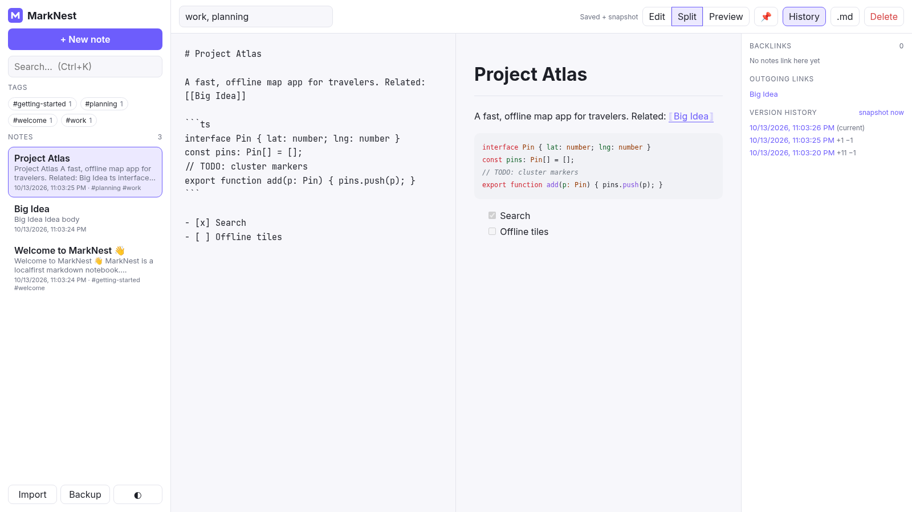
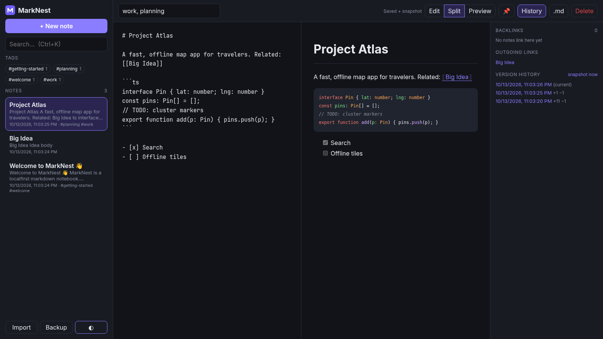
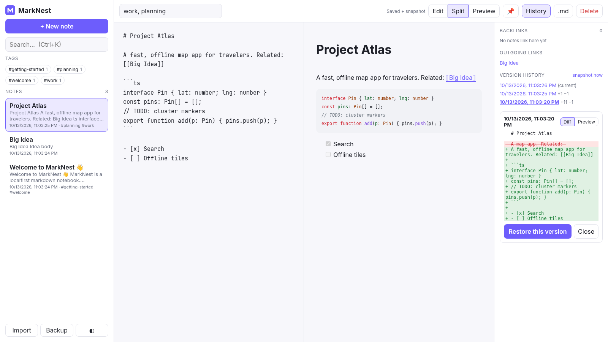

<div align="center">


# MarkNest

**A local-first, offline-ready markdown notebook that lives entirely in your browser.**

No account. No server. No tracking. Your notes never leave your device.


 



</div>

## ✨ Features

- **Live markdown editor** with edit / split / preview modes and GitHub-flavored markdown (tables, task lists, code blocks).
- **Safe rendering**: output goes through [DOMPurify](https://github.com/cure53/DOMPurify) plus extra rules. Scripts, event handlers, `javascript:` / `vbscript:` URLs, iframes, forms and inline styles are stripped, links get `rel="noopener noreferrer nofollow"`, and a strict Content-Security-Policy is applied.
- **`[[Wiki links]]`** between notes. Type `[[` to get title autocomplete; `[[Title|label]]` sets custom text. Clicking a link opens the note, or creates it if it doesn't exist yet (missing links are shown dashed in red). A **backlinks panel** lists every note that links to the current one, and **renaming a note rewrites links to it** across all notes (custom labels are kept, and code blocks are never touched).
- **Syntax highlighting** for code blocks via [highlight.js](https://highlightjs.org/) core with 14 common languages (JS/TS, Python, Go, Rust, Java, C/C++, SQL, Bash, JSON, YAML, CSS, HTML, Markdown). It emits plain `<span class="hljs-*">` markup that is still passed through DOMPurify, and the colors are CSS variables so both themes look right.
- **Per-note version history**: snapshots are taken on save (at most one every 5 minutes, or on demand with <kbd>Ctrl</kbd>+<kbd>S</kbd>), capped at 50 per note. The history panel shows timestamps and `+added −removed` line counts, a line-by-line **diff** or rendered **preview** of any version, and **one-click restore** (the current state is snapshotted first, so restores are undoable). History lives in its own IndexedDB store; existing v1 databases are migrated in place without touching notes.
- **Fast full-text search** using an in-memory inverted index with prefix matching, diacritic folding and title/tag weighting. The query syntax supports:
  - `react hooks`: all words must match (prefixes count, so `plan` finds *planning*)
  - `"exact phrase"`
  - `#tag` or `tag:work`
  - `-exclude`
- **Tags** from a tag field or inline `#hashtags`, with tag cloud filtering (AND logic) and nested tags (`#work` also matches `#work/client`).
- **IndexedDB persistence** with debounced autosave. The app also requests persistent storage so the browser doesn't evict your notes.
- **Works fully offline** as an installable PWA. The service worker precaches every built asset.
- **Import / export**: download single notes as `.md` with front matter, back up everything (including version history) to JSON, and import `.md` files or JSON backups. Imports merge by note id, and the newer edit wins.
- **Dark / light theme** (follows your system by default), **pinned notes**, a **responsive** mobile layout and **keyboard shortcuts**.
- Only **4 small runtime dependencies** (`marked`, `marked-highlight`, `highlight.js` core, `dompurify`), about 60 kB of JS gzipped.

## ⌨️ Keyboard shortcuts

| Shortcut | Action |
|---|---|
| <kbd>Alt</kbd>+<kbd>N</kbd> | New note |
| <kbd>Ctrl</kbd>/<kbd>⌘</kbd>+<kbd>K</kbd> | Focus search |
| <kbd>Ctrl</kbd>+<kbd>S</kbd> | Save now and take a snapshot |
| <kbd>[[</kbd> | Link to a note (↑/↓ + Enter/Tab to pick) |
| <kbd>Alt</kbd>+<kbd>H</kbd> | Toggle links & history panel |
| <kbd>Ctrl</kbd>+<kbd>Shift</kbd>+<kbd>S</kbd> | Download note as `.md` |
| <kbd>Ctrl</kbd>+<kbd>E</kbd> | Cycle edit → split → preview |
| <kbd>Ctrl</kbd>+<kbd>B</kbd> / <kbd>I</kbd> | Bold / italic selection |
| <kbd>Alt</kbd>+<kbd>↑</kbd>/<kbd>↓</kbd> | Previous / next note |
| <kbd>Alt</kbd>+<kbd>T</kbd> | Toggle theme |
| <kbd>?</kbd> | Shortcut help |

## 🚀 Getting started

Requires **Node.js 20.19+ or 22+**.

```bash
git clone https://github.com/Ha2mad/marknest.git
cd marknest
npm install
npm run dev        # http://localhost:5173
```

| Script | What it does |
|---|---|
| `npm run dev` | Dev server with hot reload |
| `npm test` | Unit tests (Vitest + jsdom + fake-indexeddb) |
| `npm run lint` | ESLint (typescript-eslint) |
| `npm run build` | Type-check and production build to `dist/` |
| `npm run preview` | Serve the production build (service worker active) |
| `npm run check` | Lint, test and build in one go |

## 🌐 Deploy to GitHub Pages

The build uses relative paths (`base: './'`), so it works from any sub-path such as `https://<user>.github.io/marknest/`.

1. Go to **Settings → Pages → Build and deployment** and set **Source** to **GitHub Actions**.
2. Copy `docs/ci/pages.yml` to `.github/workflows/pages.yml` (see *Continuous integration* below) and push it.
3. Go to **Actions → Deploy to GitHub Pages → Run workflow**. The workflow only runs when triggered manually.

You can host `dist/` on any static host (Netlify, Cloudflare Pages, Vercel). The service worker needs HTTPS, or `localhost`.

## ✅ Continuous integration

Ready-to-use GitHub Actions workflows live in `docs/ci/`:

- `ci.yml` runs lint, tests, build and `npm audit` on every push and pull request.
- `pages.yml` deploys to GitHub Pages when you trigger it manually.

To enable them, run:

```bash
mkdir -p .github/workflows && cp docs/ci/*.yml .github/workflows/
git add .github && git commit -m "ci: enable workflows" && git push
```

## 🏗️ Architecture

```
src/
  core/
    markdown.ts   # marked + DOMPurify rendering, URL allow-list, title derivation
    highlight.ts  # highlight.js core + registered languages
    wikilinks.ts  # [[link]] parsing, backlinks, rename rewriting, autocomplete
    diff.ts       # line-based LCS diff for version history
    search.ts     # inverted index, query parser, snippets
    tags.ts       # tag normalization, inline #hashtag extraction, filtering
    storage.ts    # IndexedDB NoteStore (v2 schema: notes + history), snapshots, backup, import/export
  main.ts         # UI wiring (vanilla TypeScript, no framework)
public/
  sw.js           # offline service worker (asset list injected at build)
tests/            # unit tests for each core module
```

The core modules have no DOM dependencies beyond DOMPurify and IndexedDB, and they're covered by unit tests, including an XSS payload suite, a 5,000-note search benchmark, wiki-link rename edge cases, snapshot throttling/capping and a v1→v2 IndexedDB migration test.

### Data model

| Store | Key | Contents |
|---|---|---|
| `notes` | `id` | `{ id, title, body, tags, createdAt, updatedAt, pinned? }` |
| `history` (v2) | `id`, index `noteId` | `{ id, noteId, title, body, tags, savedAt }` |

JSON backups are `version: 2` with `notes` and `history`; version 1 backups still import.

## 🔒 Privacy

All data stays in your browser's IndexedDB. Nothing is sent over the network, and the CSP sets `connect-src 'self'`. Clearing your site data deletes your notes, so use **Backup** regularly.

## 🗺️ Roadmap

- Optional end-to-end encrypted sync (e.g. to a WebDAV or a GitHub Gist)
- A CodeMirror editor with markdown and code highlighting while typing
- Graph view of linked notes
- Word-level diffs and history retention settings

## 📄 License

[MIT](LICENSE) © 2026 Ha2mad
